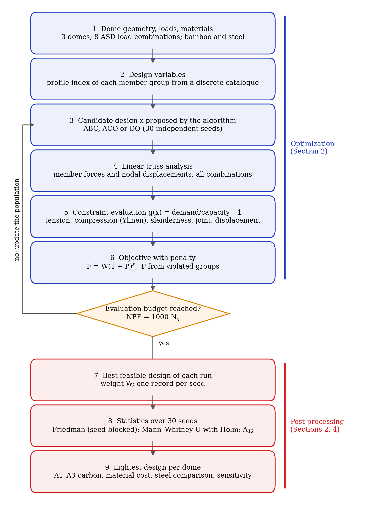
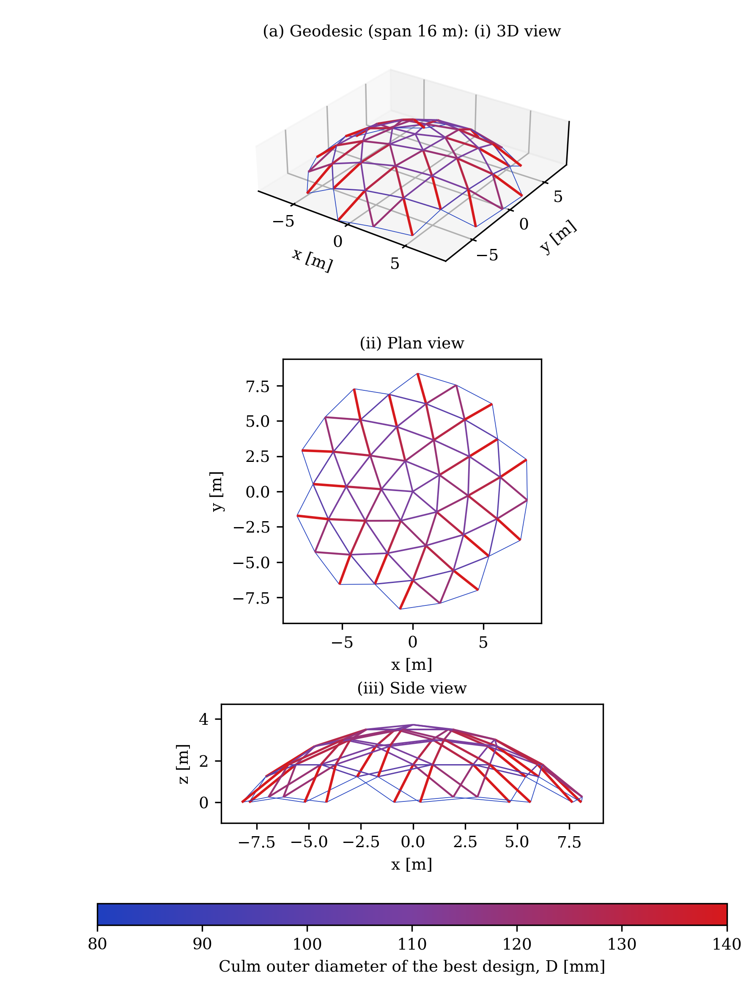
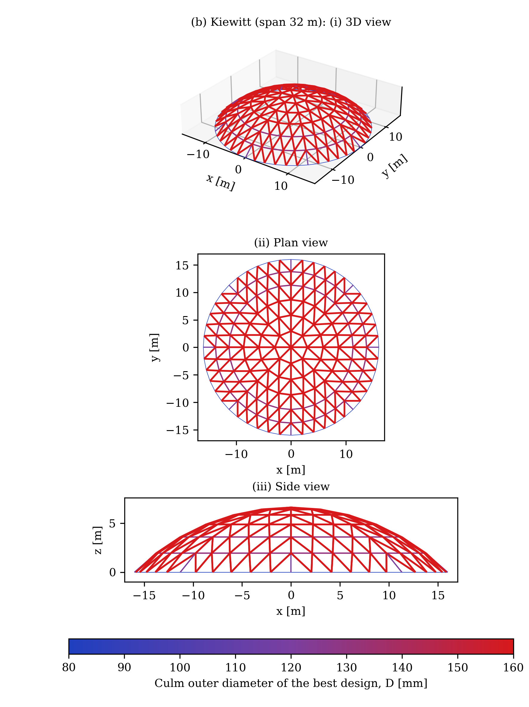
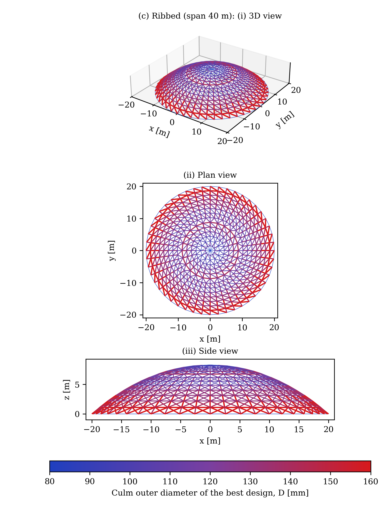
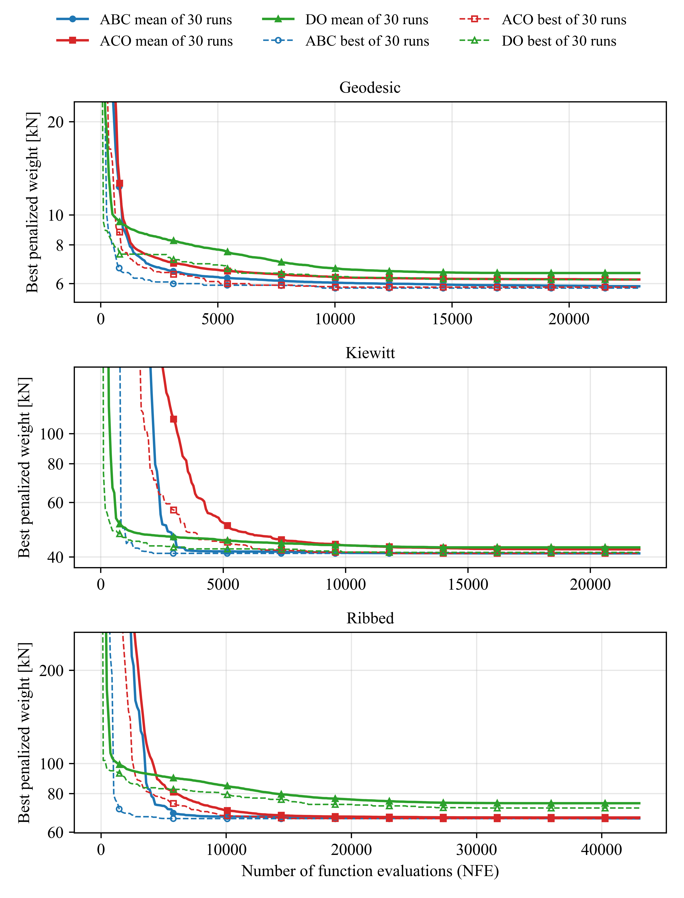
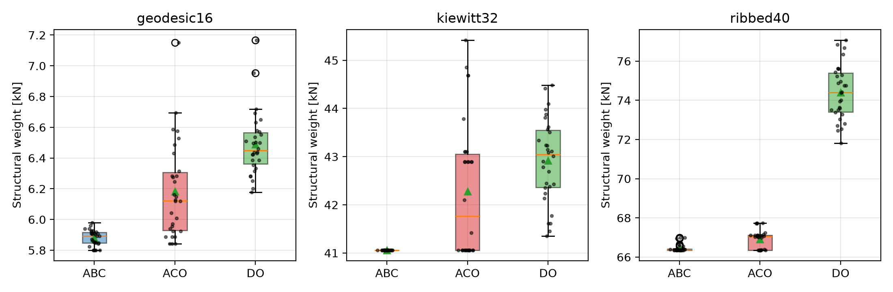
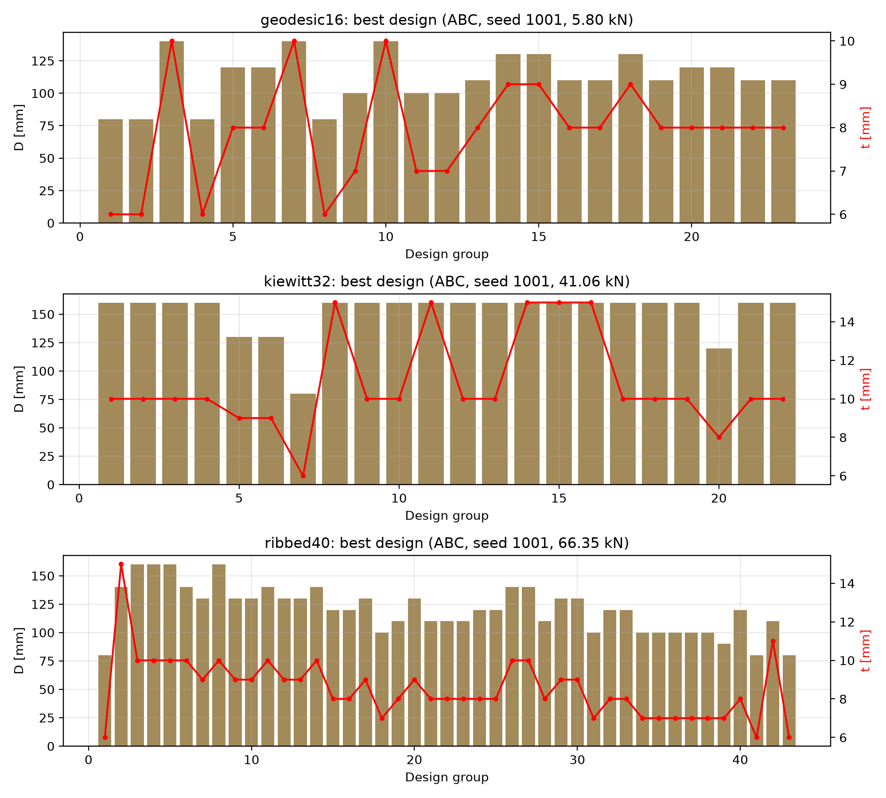
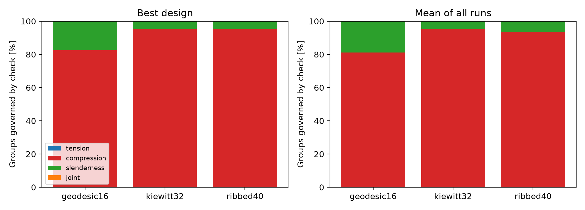
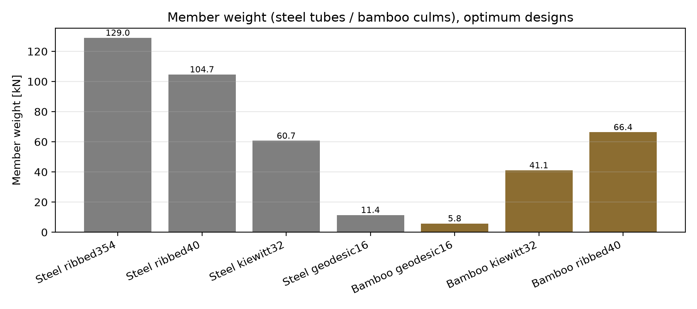
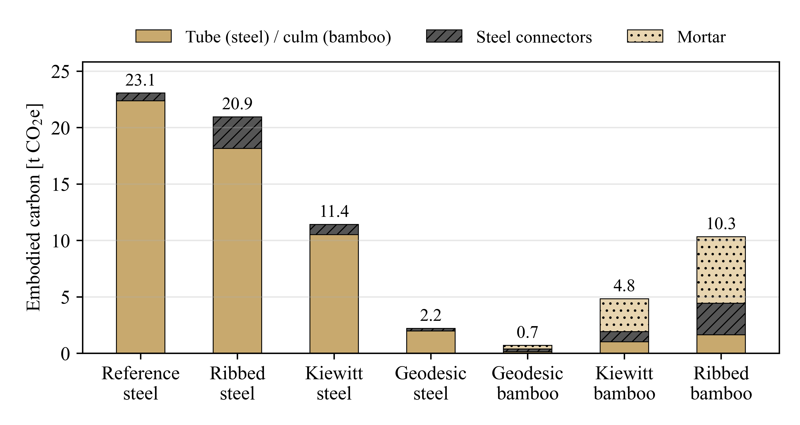

# Sizing Optimization of Guadua Bamboo Space Domes and the Share of Connection Steel and Grout in Embodied Carbon

## Highlights

- Bamboo and steel space domes sized to their own optimum for a fair comparison
- Single-objective ASD sizing with three metaheuristic algorithms and repeated runs
- Connection steel and grout carry 79–84% of the baseline carbon of the bamboo domes
- The joint carbon share falls to 43–51% at the highest culm emission factor tested
- For these three domes, bamboo systems with grout weigh more than steel systems

## Abstract

Structural bamboo is promoted as a low-carbon alternative to steel, yet comparisons in which both materials are sized to their own optimum under design-code constraints, including the connection hardware, are scarce. This study asks whether Guadua bamboo space domes are lighter, lower in embodied CO₂ and cheaper than steel domes of the same geometry. Three domes with spans of 16, 32 and 40 m were sized in bamboo under allowable stress design based on ISO 22156 and in steel under AISC allowable stress design. The weight was minimized with three metaheuristic algorithms run repeatedly from independent random starts, and the embodied carbon (A1–A3) and the material cost were evaluated for the optimum designs. The bamboo members weigh 0.51–0.68 of the steel members, and the bamboo systems carry 0.32–0.49 of the steel carbon at baseline emission factors. However, the connection steel and the grout carry 79–84% of the carbon of the bamboo domes, and the grout makes the bamboo systems heavier than the steel systems. The carbon share of the connections falls to 43–51% when the emission factor of the culm is raised to the highest value tested, so the conclusion depends on this factor. In the main price scenario, the bamboo dome costs 0.64–1.02 times the steel dome at a diameter-price exponent of 2. A fair assessment of bamboo space structures therefore has to include the connection design.

## Keywords

bamboo structures; Guadua; space truss; sizing optimization; metaheuristic algorithms; embodied carbon

# 1. Introduction

As the construction sector needs to reduce its emissions, bio-based structural materials have gained increasing prominence for load-bearing applications. Among fast-growing structural vegetation, Guadua bamboo (*Guadua angustifolia*) exhibits rapid biomass accumulation, reaching full mechanical maturation within approximately three to six years while sequestering atmospheric carbon through continuous rhizome root systems and aerial foliage [1]. Bamboo reaches its size and maximum mechanical resistance within a few years, which is advantageous in comparison with traditional timber [4]. Previous investigations on bamboo culms and laminated bio-composites have documented favorable mechanical efficiency, load-bearing capacities, and ecological performance relative to conventional structural materials such as steel, timber, concrete and brick [5, 6, 13]. In the comparative life-cycle assessment of a single-storey bamboo dwelling, reinforcing steel and transport represented 34.7% and 49.0% of the $\text{CO}_2$-equivalent emissions, respectively, whereas the structural bamboo culms themselves contributed 6.4% [6]. Complementary investigations on engineered bamboo composites and structural culms have confirmed favorable strength-to-weight ratios, characterized column buckling resistance under compression [12], and highlighted the importance of standardized structural design methodologies [9, 10], while environmental assessments of bamboo products show that processing and transport contribute substantially to the carbon balance [2–4, 6].

However, existing comparative assessments predominantly focus on raw materials, individual structural members, or whole-building envelopes. To the author's knowledge, they rarely examine spatial skeletal systems where bamboo and conventional structural steel are each optimized to their own cross-sectional limits under identical structural geometry, design loading combinations, and normative design codes. Structure-level sizing is necessary: the structural mass, financial expenditure, and embodied carbon of any spatial framework depend directly on cross-sectional efficiency, member slenderness, and connection detailing, given that spatial lattice structures incorporate numerous member ends converging at multi-directional joint hubs. Furthermore, life-cycle, embodied energy, and embodied carbon assessments across civil engineering have shown that structural framing systems and secondary components can represent substantial portions of total cradle-to-gate emissions [14, 15, 17, 18], prompting structural optimization frameworks tailored to embodied energy and carbon mitigation [16, 19]. To the author's knowledge, comparative studies evaluating structural bamboo space domes against equivalent steel configurations under normative, code-compliant sizing optimization are limited. Quantifying these trade-offs across material weight, embodied $\text{CO}_2$, and direct cost addresses this gap.

Connection detailing constitutes a primary mechanical challenge in structural bamboo engineering. Bolted connections with mortar or grout infill represent key engineering considerations in bamboo design, largely due to brittle splitting failure modes under concentrated mechanical stresses and inherent natural variability [8]. Laboratory experiments on unreinforced bolted bamboo culms show premature failure governed by longitudinal splitting along the fibers; while flowable mortar or cementitious grout infill improves bearing and shear capacity, it alters joint ductility [7, 8]. Standard design guidelines, including the IStructE design manual for ISO 22156, describe the use of flowable infill material, typically a cementitious grout, to secure internal threaded rods and steel hardware [1]. Nevertheless, experimental investigations in the literature have mostly concentrated on single-joint tests and empirical connection capacity formulation [7, 8, 11]. The cumulative mass, volumetric infill, and embodied carbon that steel connectors and cementitious grout introduce to an entire three-dimensional space structure—and how these burdens scale with increasing span and topological member density—have, to the author's knowledge, rarely been quantified. Consequently, whether the low embodied carbon and lightweight advantages of raw bamboo culms persist once connection hubs, sleeve hardware, and end-zone grout are fully integrated remains an open engineering question for space truss systems.

A comparison between alternative structural materials requires an objective, code-compliant sizing strategy. Mathematical and metaheuristic optimization provides this unified basis: each spatial system is driven to its minimum feasible weight under identical structural layouts, load combinations, and allowable stress design constraints, allowing direct comparison of global performance. Following foundational sizing optimization formulations for skeletal steel frameworks under allowable stress and displacement constraints [29], metaheuristic optimization algorithms have been extensively employed for the discrete section sizing of real-size pin-jointed and skeletal steel structures [20, 21]. Prominent metaheuristics, such as artificial bee colony (ABC) algorithms and ant colony optimization (ACO), have been applied to complex spatial steel trusses and frames [22–24]. Similarly, contemporary bio-inspired optimizers, such as the dandelion optimizer (DO), have recently been explored in steel buildings with reinforced concrete shear cores [25]. Despite widespread application in steel structures, the deployment of metaheuristic sizing algorithms to structural bamboo space systems governed by wood- and bio-composite design standards has, to the author's knowledge, received little attention.

Within this framework, whether an optimally sized Guadua bamboo space dome achieves advantages over an equivalent steel dome in terms of structural weight, cradle-to-gate embodied carbon, and material cost—particularly when connection steel and grout infill are fully accounted for—is the question of this study. To resolve this question, the present study offers a threefold contribution: (i) a normative, code-based discrete sizing optimization formulation for bamboo space domes that explicitly incorporates allowable stress design, member slenderness, and joint load-carrying capacities; (ii) an optimum-versus-optimum comparison against structural steel domes across structural mass, cradle-to-gate embodied carbon, and material cost; and (iii) a post-optimization parametric sensitivity analysis evaluating the governing role of connection steel and grout infill in the total embodied emissions.

To realize these objectives, the investigation addresses four interconnected structural tasks: (i) formulating the discrete sizing problem for both bamboo and steel domes under governing design codes (ISO 22156 / NSR-10 and AISC ASD); (ii) executing the optimization across three representative space dome topologies using three distinct metaheuristic algorithms (ABC, ACO, and DO), each initiated from 30 independent random starting seeds to obtain a statistical sample; (iii) evaluating the cradle-to-gate (A1–A3) embodied CO₂ and material cost of all resulting optimal structural configurations, including sensitivity sweeps across culm emission factors, grout lengths, and geographic material price scenarios; and (iv) benchmarking the structural, environmental, and financial trade-offs between bamboo and conventional steel space domes.

The employment of three metaheuristic algorithms combined with replicated runs addresses the inherent stochasticity of heuristic search. Because metaheuristic search trajectories depend on pseudo-random sequences and the global optimum of large-scale discrete structural problems cannot be proven a priori, multiple independent algorithms provide useful algorithmic cross-validation. Furthermore, executing 30 independent random runs per algorithm across each dome topology provides an empirical distribution of optimization performance, enabling non-parametric hypothesis testing (Friedman and Mann–Whitney U tests) to evaluate stability, convergence speed, and repeatability.

The remainder of this paper is structured as follows. Section 2 formulates the single-objective structural sizing optimization problem, constraint handling, algorithmic procedures, and post-optimization carbon and cost methodologies. Section 3 details the numerical benchmark domes, material databases, load combinations, algorithmic control parameters, and lifecycle inventory data. Section 4 presents the optimization results, convergence profiles, limit state distributions, and comparative carbon and cost balances. Section 5 discusses the biomechanical mechanisms, connection hardware impacts, and practical design implications. Finally, Section 6 summarizes the main conclusions.

# 2. Optimization problem formulation and solution method

This section formulates the structural discrete sizing optimization framework for both bamboo space domes and their benchmark steel counterparts. The integrated computational methodology addresses structural mass minimization alongside post-optimization cradle-to-gate embodied carbon ($E_{\text{CO}_2}$) and material cost ($C$) evaluations. Metaheuristic search procedures, constraint handling, and statistical hypothesis testing are described, while mathematical derivations, algorithmic equations, and normative code factors are compiled in the Supplementary Material.

Figure 1 illustrates the overall multi-stage computational workflow of the sizing optimization and life-cycle evaluation methodology. The framework is organized into two primary phases: (i) the structural optimization phase (Steps 1–6), where discrete member profile indices are iteratively updated by metaheuristic optimizers (ABC, ACO, DO) under allowable stress design (ASD) constraints and member slenderness limits until the computational budget ($NFE = 1000\,N_g$) is exhausted; and (ii) the post-processing phase (Steps 7–9), wherein the lightest feasible structural configurations are extracted, statistical convergence across 30 independent random starting seeds is evaluated via non-parametric hypothesis tests, and cradle-to-gate embodied carbon emissions and international material costs are quantified.

**Figure 1.** Multi-stage computational flowchart of the research methodology: (i) structural sizing optimization phase (Steps 1–6) coupling discrete member profile updates, linear stiffness analysis, and normative ASD constraint evaluation under a fixed evaluation budget ($NFE = 1000\,N_g$); and (ii) post-processing phase (Steps 7–9) evaluating statistical convergence across 30 independent random starting seeds, cradle-to-gate embodied carbon balances, and international material cost trade-offs.

## 2.1 Design variables

The structural geometry (nodal spatial coordinates, member-node topology, and boundary support restraints) and applied external design loads are kept invariant. Cross-sectional profiles are sized via discrete sizing optimization. To satisfy architectural modularity and fabrication practicalities, the $N_m$ structural members are partitioned into $N_g$ design groups, such that all members belonging to group $\ell$ share the identical cross-section. The vector of discrete design variables is defined as:

$$\mathbf{x} = [x_1, x_2, \dots, x_{N_g}], \qquad x_\ell \in \{1, 2, \dots, n_s\} \tag{1}$$

where $x_\ell$ denotes the integer profile pointer of group $\ell$ within an ordered discrete section catalogue comprising $n_s$ structural candidates. For the bamboo domes, the discrete library contains $n_s = 24$ hollow circular Guadua culm cross-sections, whereas the steel library includes $n_s = 37$ standard AISC structural pipe sections (detailed in Section 3.2; the 24 bamboo sections are listed in Supplementary Material Table S1). All elements are idealized as pin-jointed truss bars carrying pure axial forces.

## 2.2 Objective function formulation and multi-criteria evaluation scope

In structural optimization of nature-based composite systems, mass, material expenditure, and embodied carbon form interconnected performance metrics. In this study, the direct search objective is formulated as the total mass/weight of the structural load-bearing members:

$$W(\mathbf{x}) = g_0\,\rho \sum_{i=1}^{N_m} A_i(\mathbf{x})\,L_i \tag{2}$$

where $g_0 = 9.81\text{ m/s}^2$ is the acceleration of gravity, $\rho$ is the material density (kg/m³), $A_i(\mathbf{x})$ is the cross-sectional area of member $i$ determined by its group profile index, $L_i$ is member length, and $N_m$ is the total number of members. The single-objective constrained optimization problem is posed as:

$$\min_{\mathbf{x}} \; W(\mathbf{x}) \quad \text{subject to} \quad g_k(\mathbf{x}) \le 0, \quad k = 1, \dots, N_c \tag{3}$$

where $g_k(\mathbf{x})$ represents the set of normative strength, stability, slenderness, joint capacity, and serviceability constraints defined in Sections 2.3 and 2.4. 

While structural member weight is selected as the direct objective variable—ensuring that the numerical search remains entirely uncoupled from market price fluctuations and regional emission-factor variabilities—the overall research scope encompasses a tripartite optimization and assessment framework. Every feasible optimum design generated by the optimization engine is immediately evaluated for its complete cradle-to-gate embodied carbon footprint ($E_{\text{CO}_2}$) and total material capital cost ($C$), explicitly incorporating connection hubs, threaded fasteners, and end-zone grout cores (Sections 2.6 and 2.7). This enables an integrated mass–carbon–cost trade-off analysis across alternative material systems.

## 2.3 Constraints of the bamboo space dome

All structural constraint functions are cast in normalized demand-to-capacity (D/C) format, $g = (\text{demand} / \text{capacity}) - 1 \le 0$. Each individual member $i$ is evaluated across all eight governing allowable stress design (ASD) load combinations $j = 1, \dots, 8$ (Section 3.3). Let $N_{ij}$ denote the computed elastic axial member force (positive for tension, negative for compression). Structural design conforms to the allowable stress design framework of ISO 22156:2021 [36] and the IStructE design manual [1]. The allowable member load-bearing capacity is determined as:

$$X_{allow} = \frac{x_k\,C_R\,C_{DF}\,C_T}{FS} \tag{4}$$

where $x_k$ represents the characteristic material capacity, $C_R$ is the structural redundancy factor, $C_{DF}$ is the load-duration adjustment factor, $C_T$ is the operational temperature factor, and $FS$ is the prescribed factor of safety (Equation 3.9 in [1]). Computationally, rather than de-rating capacities for each load case, the member axial force is scaled by the combined factor $k_j$, maintaining identical demand-to-capacity ratios:

$$k_j = \frac{C_R\,C_{DF,j}\,C_T}{FS}, \qquad \tilde{N}_{ij} = \frac{N_{ij}}{k_j} \tag{5}$$

**Tension capacity constraints.** The normalized axial tension force is checked against the characteristic parallel-to-fiber tensile capacity:

$$g^t_{ij}(\mathbf{x}) = \frac{\max(\tilde{N}_{ij}, 0)}{A_i\,f_{t,0,k}} - 1 \le 0 \tag{6}$$

where $f_{t,0,k}$ is the characteristic tensile strength of the culm.

**Compression and flexural column buckling constraints.** Axial compression is checked against the characteristic critical buckling stress $f_{cr,i}$ governed by Ylinen's non-linear column formulation [1, 12, 36]:

$$g^c_{ij}(\mathbf{x}) = \frac{\max(-\tilde{N}_{ij}, 0)}{A_i\,f_{cr,i}} - 1 \le 0 \tag{7}$$

$$f_{cr,i} = \frac{f_{c,0,k} + f_{e,i}}{2c} - \sqrt{\left(\frac{f_{c,0,k} + f_{e,i}}{2c}\right)^2 - \frac{f_{c,0,k}\,f_{e,i}}{c}} \tag{8}$$

$$f_{e,i} = \frac{\pi^2 E_k\,C_{bow}}{\lambda_i^2}, \qquad \lambda_i = \frac{K\,L_i}{r_i}, \qquad C_{bow} = 1 - \frac{b_0}{0.02} \tag{9}$$

where $f_{c,0,k}$ is the characteristic parallel compressive strength, $E_k$ is the characteristic elastic modulus, $c$ is the dimensionless Ylinen interaction constant, $\lambda_i$ is column slenderness, $K$ is the effective length factor ($K = 1.0$ for pinned ends), $r_i$ is the radius of gyration, and $C_{bow}$ is the reduction factor accounting for initial culm crookedness ($b_0$). Experimental validation of column buckling behavior and Ylinen constants for Guadua culms is detailed by Bahtiar et al. [12], while complete mechanical derivations are provided in Supplementary Material Appendix S3.

**Geometric slenderness constraints.** To prevent excessive flexibility during transport, erection, and service life, maximum slenderness is constrained according to Title G of the Colombian seismic building code NSR-10 [37]:

$$g^s_i(\mathbf{x}) = \frac{\lambda_i}{\lambda_{max}} - 1 \le 0 \tag{10}$$

where $\lambda_{max} = 150$ is enforced across all structural elements as a conservative bound.

**Connection capacity constraints.** Connection load-carrying capacity is evaluated using unscaled elastic forces, as codified bolt allowable values already incorporate internal factors of safety:

$$g^n_{ij}(\mathbf{x}) = \frac{|N_{ij}|}{F_{j,Rd}} - 1 \le 0, \qquad F_{j,Rd} = n_{bolt}\,F_{bolt,adm}\,C_g \tag{11}$$

where $F_{bolt,adm}$ is the allowable double-shear capacity of a single steel bolt embedded in a mortared bamboo culm based on NSR-10 (Table G.12.11-2 [37]) and empirical connection tests on Guadua culms [11], $n_{bolt}$ is the number of through-bolts per member end, and $C_g$ is the bolt group modification factor (Table G.12.11-3 of NSR-10).

**Serviceability deflection constraints.** Overall structural serviceability is governed by the peak nodal translation across all active load combinations:

$$g^u(\mathbf{x}) = \frac{u_{max}(\mathbf{x})}{u_{lim}} - 1 \le 0 \tag{12}$$

where $u_{max}(\mathbf{x})$ is the maximum spatial displacement component among all unrestrained nodes, and $u_{lim} = \text{span}/150$ is the serviceability deflection limit adopted following general design recommendations in the IStructE bamboo design manual [1].

## 2.4 Constraints of the steel space dome

The benchmark steel space domes are optimized under the identical structural geometry, member grouping, and unfactored ASD load combinations in accordance with AISC ASD 9th Edition specifications [34]. Standard tension, compression, slenderness, and displacement constraints are formulated as:

$$g^t_{ij} = \frac{\max(N_{ij}, 0)}{0.6\,F_y\,A_i} - 1 \le 0, \qquad g^c_{ij} = \frac{\max(-N_{ij}, 0)}{F_{a,i}\,A_i} - 1 \le 0, \qquad g^s_i = \frac{\lambda_i}{\lambda_{max}} - 1 \le 0 \tag{13}$$

with maximum permissible slenderness limits of $\lambda_{max} = 200$ for compression members and $\lambda_{max} = 300$ for tension members, alongside the global displacement constraint $g^u$ (Equation 12). Allowable compressive stress $F_{a,i}$ is defined by the column buckling curve:

$$F_a = \frac{\left[1 - \dfrac{\lambda^2}{2C_c^2}\right]F_y}{\dfrac{5}{3} + \dfrac{3\lambda}{8C_c} - \dfrac{\lambda^3}{8C_c^3}} \quad (\lambda < C_c), \qquad F_a = \frac{12\pi^2 E}{23\,\lambda^2} \quad (\lambda \ge C_c), \qquad C_c = \sqrt{\frac{2\pi^2 E}{F_y}} \tag{14}$$

where $F_y$ is steel yield stress and $E$ is Young's modulus.

## 2.5 Constraint handling, metaheuristic optimizers, and statistical framework

**Multiplicative penalty formulation.** Constraint violations are collected into a composite penalty metric $P(\mathbf{x})$ that evaluates the maximum constraint violation among members within each group alongside the displacement deficit:

$$P(\mathbf{x}) = \sum_{\ell=1}^{N_g} \max\!\Bigl(0, \max_{i\in\ell} \hat{g}_i\Bigr) + \max\bigl(0, g^u\bigr) \tag{15}$$

where $\hat{g}_i = \max_{j}\{g^t_{ij}, g^c_{ij}, g^n_{ij}, g^s_i\}$. The metaheuristic optimizers minimize the penalized structural weight function:

$$F(\mathbf{x}) = W(\mathbf{x})\,\bigl(1 + P(\mathbf{x})\bigr)^\varepsilon, \qquad \varepsilon = 2 \tag{16}$$

For any feasible design vector satisfying all constraints, $P(\mathbf{x}) = 0$, reducing $F(\mathbf{x})$ identically to the true structural weight $W(\mathbf{x})$.

**Metaheuristic optimizers and supplementary material overview.** Sizing optimization is conducted using three distinct metaheuristic algorithms implemented in-house for discrete index vectors: the Artificial Bee Colony (ABC) algorithm [26], Ant Colony Optimization (ACO) [27], and the Dandelion Optimizer (DO) [28]. ABC simulates the foraging behavior of honeybees via employed, onlooker, and scout phases, balancing local intensification and random global exploration. ACO models pheromone trail laying and evaporation along discrete section choices, favoring efficient structural selections through cumulative collective memory. DO is a recently introduced bio-inspired optimizer mimicking dandelion seed wind-borne flight across rising, descending, and landing stages via Lévy-flight perturbations. 

To maintain manuscript conciseness and avoid redundant mathematical expositions, the complete algorithmic procedures, and parameter update equations for ABC, ACO, and DO are detailed in Supplementary Material Appendix S1.

**Statistical hypothesis testing.** Because metaheuristic methods are stochastic, each optimizer is executed across 30 independent random starting seeds (1001–1030) per dome geometry. Algorithmic performance is evaluated using non-parametric statistics [32]. A seed-blocked Friedman rank test is conducted across the three algorithms for each dome to test the null hypothesis of equal performance. Pairwise differences between the control algorithm (ABC, which achieved the lowest mean rank across all domes) and competing optimizers are assessed using two-sided Mann–Whitney U tests with Holm correction at $\alpha = 0.05$. The Vargha–Delaney $A_{12}$ non-parametric effect size is evaluated to quantify the stochastic dominance probability [33]. Complete formulations and test definitions are compiled in Supplementary Material Appendix S2.

## 2.6 Embodied carbon evaluation framework

Cradle-to-gate embodied carbon emissions (EN 15978 stages A1–A3) are calculated for the optimal design of each space dome:

$$E_{\text{CO}_2} = EC_b\,m_b + EC_s\,m_s + EC_m\,m_m \tag{17}$$

where $EC_b$, $EC_s$, and $EC_m$ represent the carbon emission factors (kg CO₂e/kg) for bamboo culms, structural connection steel, and cementitious grout infill, while $m_b$, $m_s$, and $m_m$ represent their respective masses. Culm mass is $m_b = \rho \sum_i A_i L_i$. Connection steel mass incorporates nodal hubs and member-end connector assemblies: $m_s = m_{hub}N_n + 2\,m_{end}N_m$, with $N_n$ nodes and $N_m$ members. Injected grout core mass is calculated across both ends of every bamboo culm:

$$m_m = \sum_{i=1}^{N_m} 2\,\rho_m\,\frac{\pi}{4}\,(D_i - 2t_i)^2\,(\beta\,D_i) \tag{18}$$

where $\rho_m$ is grout density, $D_i$ is culm outer diameter, $t_i$ is wall thickness, and $\beta$ is the dimensionless grout infill length ratio ($\beta = L_{grout} / D$). For steel domes, $E_{\text{CO}_2} = EC_{pipe}m_{pipe} + EC_s m_s$, assuming identical steel connection hub mass and zero grout. The joint carbon share, defined as $(EC_s m_s + EC_m m_m) / E_{\text{CO}_2}$, is subjected to single-parameter and multi-parameter sensitivity sweeps (Section 4.4).

## 2.7 Material cost formulation

Direct structural material costs are modeled without consideration of site labor, transportation logistics, or long-term maintenance:

$$C_{bamboo} = \sum_{i=1}^{N_m} L_i\,p_b(D_i) + p_s\,m_s + p_g\,m_m, \qquad p_b(D) = p_{ref}\left(\frac{D}{D_{ref}}\right)^\alpha \tag{19}$$

where $p_b(D)$ represents the diameter-dependent bamboo price per linear meter, scaled nonlinearly from reference unit cost $p_{ref}$ at base diameter $D_{ref}$ through exponent $\alpha \in [1.5, 3.0]$; $p_s$ and $p_g$ denote unit material prices (USD/kg) for steel and grout. For steel domes, total material expenditure is $C_{steel} = p_s(m_{pipe} + m_s)$. Unit price inventories across four international economic regions are documented in Section 3.5.

# 3. Numerical examples

This section establishes the benchmark structural applications, material inventories, external action profiles, algorithmic tuning configurations, and life cycle cost/carbon inventories. Three distinct single-layer space dome topologies spanning 16 m to 40 m are evaluated under identical geometry, external loading combinations, and boundary restraints for both bamboo and steel systems, ensuring that differences in structural performance stem strictly from material mechanics and normative design philosophies.

## 3.1 Space dome topologies, geometry, and design grouping

To investigate scale effects and geometric sensitivity, three benchmark space domes encompassing diverse structural typologies were selected: a 16 m geodesic dome, a 32 m Kiewitt dome, and a 40 m ribbed (Schwedler-type) dome. The geometric characteristics, grid layouts, and structural configurations are summarized in Table 1, with the generation algorithms and the wind pressure zoning given in Supplementary Material Appendix S4.

| Dome Topology | Code Designation | Span [m] | Rise [m] | Nodes ($N_n$) | Members ($N_m$) | Design Groups ($N_g$) | Supported Nodes | Member Length Range [m] | $u_{lim}$ [mm] |
|---|---|---|---|---|---|---|---|---|---|
| Geodesic | geodesic16 | 16.0 (nominal) | 3.72 | 46 | 115 | 23 | 20 | 2.24–2.96 | 107 |
| Kiewitt | kiewitt32 | 32.0 | 6.60 | 169 | 456 | 22 | 48 | 2.09–3.55 | 213 |
| Ribbed | ribbed40 | 40.0 | 8.28 | 505 | 1464 | 43 | 48 | 0.76–3.08 | 267 |

**Table 1.** Geometric parameters and modeling properties of the benchmark space domes. $u_{lim} = \text{span}/150$.

The spatial layout of each dome configuration reflects standard spatial truss typologies established in the structural optimization literature [20, 29–31]:
- **Geodesic Dome (16 m span):** Based on an icosahedral spherical geometry (Class I, subdivision frequency 5) truncated at a colatitude of 50°. The structure features 46 joints and 115 members categorized into 23 independent cross-sectional sizing groups based on latitude rings and 72° five-fold rotational symmetry. All 20 perimeter base joints along the zigzag boundary are pinned in all translational degrees of freedom. Member lengths range between 2.24 m and 2.96 m.
- **Kiewitt Dome (32 m span):** Formed as a spherical cap divided into 8 symmetric circumferential sectors with 6 concentric horizontal rings, encompassing 169 nodes and 456 members. Members are partitioned into 22 design groups according to ring position and radial orientation. The 48 outermost perimeter base nodes are pinned. Member lengths vary from 2.09 m to 3.55 m.
- **Ribbed (Schwedler-type) Dome (40 m span):** Derived from the well-established 40 m, 354-member benchmark space dome extensively investigated in steel optimization literature [20, 29–31]. In the original 354-member geometry, member lengths reach up to 5.97 m, which exceeds practical unbraced buckling limits for naturally grown structural bamboo culms. To make the topology viable for natural bio-materials without violating transportable culm lengths, a frequency-2 topological densification was executed, generating 505 nodes, 1464 members, and 43 design groups with member lengths strictly constrained between 0.76 m and 3.08 m. The 48 foundation support nodes are pinned.
- **Classical 354-Member Steel Reference Dome:** In addition to the three bio-structural benchmark domes, the classical 40 m span, 354-member, 22-group Schwedler-type steel dome [20, 29–31] was analyzed under identical loading conditions as an external literature calibration anchor.

Figure 2 illustrates the spatial layouts, plan projections, elevation profiles, and optimal cross-sectional diameter allocations across the three benchmark space domes: (a) 16 m Geodesic dome, (b) 32 m Kiewitt dome, and (c) 40 m Ribbed dome, where each dome panel depicts (i) 3D perspective view, (ii) plan view, and (iii) side elevation view. The generation algorithms of the node coordinates are given in Supplementary Material Appendix S4.

*(a) 16 m Geodesic dome: (i) 3D view, (ii) plan view, (iii) side view*

*(b) 32 m Kiewitt dome: (i) 3D view, (ii) plan view, (iii) side view*

*(c) 40 m Ribbed dome: (i) 3D view, (ii) plan view, (iii) side view*

**Figure 2.** Spatial topology, plan projections, elevation profiles, and optimal cross-sectional diameter allocations across the three benchmark space domes: (a) 16 m Geodesic dome, (b) 32 m Kiewitt dome, and (c) 40 m Ribbed dome. For each dome topology, the respective panel displays: (i) 3D perspective view, (ii) plan view, and (iii) side elevation view, along with the color-coded culm outer diameter $D$ [mm] scale bar.

Elastic structural analysis is performed using an in-house direct stiffness solver verified against commercial finite element software (CSI SAP2000 v24). Serviceability displacement thresholds are adopted as an engineering design assumption set to $u_{lim} = \text{span}/150$, adapted from general flexural member serviceability guidance in the IStructE design manual [1] (since neither ISO 22156 nor NSR-10 specifies global roof deflection limits for reticulated spatial structures), yielding limits of 107 mm, 213 mm, and 267 mm, respectively.

## 3.2 Material mechanical properties and discrete profile catalogues

Material properties, allowable stress limits, and design factors for *Guadua angustifolia* bamboo are established in strict accordance with ISO 22156:2021 [36], the IStructE bamboo design manual [1], and NSR-10 Title G [37], drawing upon characteristic experimental evaluations of structural bamboo culms [13]. Table 2 presents the material parameters and design factors adopted in the analysis.

| Mechanical / Design Property | Design Value | Codified Source and Justification |
|---|---|---|
| Material density $\rho$ | 700 kg/m³ | ISO 22156 / IStructE Manual Table 4.4; Guadua mean is 680 kg/m³ |
| Characteristic elastic modulus $E_k$ | 10,000 MPa | Conservative baseline from Table 4.4 of [1] |
| Characteristic tensile strength $f_{t,0,k}$ | 40.0 MPa | Table 4.4 of [1] |
| Characteristic compressive strength $f_{c,0,k}$ | 37.8 MPa | Table A3.4 of [1] (Guadua angustifolia database, $n = 922$) |
| Safety factor $FS$ | 2.0 | Appendix A3.6 of [1] for axial truss members |
| Redundancy factor $C_R$ | 0.90 | IStructE Manual Section 6.3 and ISO 22156:2021 Clause 5.4 for single-culm primary members |
| Temperature adjustment factor $C_T$ | 1.00 | Service temperatures $\le 38^\circ\text{C}$ [1] |
| Load duration factors $C_{DF}$ | 0.55 / 0.65 / 0.85 | Permanent (D) / Transient (S) / Instantaneous (W) [1] |
| Ylinen non-linear interaction constant $c$ | 0.80 | Appendix A6.2 of [1] |
| Dimensionless initial culm crookedness $b_0$ | 0.01 | Typical natural bow, yielding $C_{bow} = 0.50$ [1] |
| Effective column length factor $K$ | 1.00 | Table 6.1 of [1] for pin-jointed space truss members |
| Maximum slenderness limit $\lambda_{max}$ | 150 | NSR-10 Section G.12.9.2.6 [37] applied to all members |
| Codified connection joint capacity $F_{j,Rd}$ | 49.3 kN | Nominal baseline from NSR-10 Tables G.12.11-2 and G.12.11-3 for $D \ge 100$ mm ($F_{bolt,adm} = 13.25\text{ kN}$, $n_{bolt} = 4$, $C_g = 0.93$; for $D = 80$ mm NSR-10 specifies 11.54 kN) |
| Maximum nodal deflection limit $u_{lim}$ | $\text{span}/150$ | Engineering design assumption adapted from IStructE Manual guidance [1] (Section 3.1) |

**Table 2.** Mechanical properties, partial factors, and design parameters for the Guadua bamboo space domes.

The discrete bamboo catalogue comprises $n_s = 24$ commercially viable Guadua culm cross-sections, with outer diameters ranging from $D = 80$ mm to $160$ mm and wall thicknesses from $t = 6$ mm to $22$ mm (detailed in Supplementary Material Table S1). 

The baseline joint design specifies four through-bolts ($n_{bolt} = 4$) of grade #5 (5/8 in / 15.9 mm diameter) embedded in an injected mortar/grout core at each member end, providing an allowable design capacity of $F_{j,Rd} = 4 \times 13.25 \times 0.93 = 49.3$ kN pursuant to NSR-10 Title G [37]. Standard bolt spacing requirements in NSR-10 Title G prescribe a minimum pitch of 150 mm between successive bolts and end distances of 150 mm for tension members and 100 mm for compression members. Housing four bolts across both member ends requires $2 \times [e + (n_{bolt}-1)p] = 2 \times [150 + 3 \times 150] = 1.20$ m of culm length, which expands to approximately 1.35 m when maintaining a nominal 150 mm unperforated mid-span clearance between opposite connection zones.

For the benchmark steel domes, the discrete catalogue consists of 37 standard AISC steel pipe sections with yield strength $F_y = 248.2$ MPa, Young's modulus $E = 205$ GPa, and steel density $\rho = 7850$ kg/m³ [20, 34], designed under AISC ASD specifications.

## 3.3 Design loads and ASD load combinations

Applied nominal design load magnitudes (dead, snow, and wind velocity pressure) are adapted from benchmark space dome literature [20, 30, 31]. While classical literature studies evaluated three simplified loading cases under historical ASCE 7-98 provisions, the present study establishes a design basis by evaluating eight unfactored ASD load combinations in strict accordance with ASCE 7-22 [35] (Table 4) applied identically to both bamboo and steel dome configurations:
- **Nominal Dead Load ($D$):** 0.20 kN/m² applied vertically downward on the horizontal projected area.
- **Nominal Snow Load ($S$):** 0.83 kN/m² applied vertically downward on the horizontal projected area.
- **Wind Actions ($W$):** Computed using wind velocity pressure $q_h = 1.115$ kN/m², gust factor $G = 0.85$, and aerodynamic pressure coefficients $C_p$ distributed across three spatial windward, leeward, and crest zones along the wind axis $x$: $C_p = +0.0105$ for $x < -L_d/4$, $C_p = -0.907$ for $|x| \le L_d/4$, and $C_p = -0.50$ for $x > L_d/4$ ($L_d$ is the dome span). Internal pressure coefficients are taken as $GC_{pi} = -0.18$ (pattern $W_N$) and $+0.18$ (pattern $W_P$), producing the net surface pressures documented in Table 3.

| Wind Load Pattern | Windward Zone ($x < -L_d/4$) | Central Crest Zone ($|x| \le L_d/4$) | Leeward Zone ($x > L_d/4$) |
|---|---|---|---|
| Pattern $W_N$ ($GC_{pi} = -0.18$) | $+0.211\text{ kN/m}^2$ | $-0.659\text{ kN/m}^2$ | $-0.273\text{ kN/m}^2$ |
| Pattern $W_P$ ($GC_{pi} = +0.18$) | $-0.191\text{ kN/m}^2$ | $-1.060\text{ kN/m}^2$ | $-0.675\text{ kN/m}^2$ |

**Table 3.** Distributed aerodynamic wind surface pressures. Positive values denote inward pressure.

Surface tributary loads are lumped onto structural joints via surface triangular discretization. Eight unfactored ASD load combinations are systematically evaluated in accordance with ASCE 7-22 [35], as summarized in Table 4.

| No. | Load Combination | Governing Duration Class | $C_{DF}$ | Combined ASD Scaling Factor $k_j$ |
|---|---|---|---|---|
| 1 | $D$ | Permanent | 0.55 | 0.2475 |
| 2 | $D + S$ | Transient | 0.65 | 0.2925 |
| 3 | $D + 0.6W_N$ | Instantaneous | 0.85 | 0.3825 |
| 4 | $D + 0.6W_P$ | Instantaneous | 0.85 | 0.3825 |
| 5 | $D + 0.75S + 0.45W_N$ | Instantaneous | 0.85 | 0.3825 |
| 6 | $D + 0.75S + 0.45W_P$ | Instantaneous | 0.85 | 0.3825 |
| 7 | $0.6D + 0.6W_N$ | Instantaneous | 0.85 | 0.3825 |
| 8 | $0.6D + 0.6W_P$ | Instantaneous | 0.85 | 0.3825 |

**Table 4.** ASD load combinations, duration categories, and resulting capacity factors $k_j$ (Equation 5).

## 3.4 Optimization algorithm execution settings

To ensure equitable computational budgets across topologies of varying dimensionality, each algorithmic run terminates strictly after $NFE = 1000\,N_g$ structural analyses: 23,000 evaluations for the 16 m Geodesic dome, 22,000 for the 32 m Kiewitt dome, and 43,000 for the 40 m Ribbed dome. Population sizes were set to 20 for ABC and 40 for ACO and DO, in relation to the number of design variables (23 to 43) and in line with the practice in [25]. A preliminary tuning study with three to five seeds per setting (Supplementary Material S1.4) ranked ABC first, ACO second and DO third; for the three methods it also found other best-performing sizes on some domes (Table S1.1), and the production runs kept one size for each of the two methods on all domes. 

Every algorithm was independently executed across 30 random seeds (1001–1030) per dome, resulting in 270 full optimization runs for the bamboo domes (3 topologies × 3 algorithms × 30 seeds). For the benchmark steel domes, the ABC algorithm was executed under identical evaluation budgets across the same 30 random seeds for all three benchmark domes and the classical 354-member reference dome, totaling 120 steel optimization runs (4 models × 30 seeds).

## 3.5 Embodied carbon factors and international material cost inventories

**Connection detailing hardware.** The baseline spatial truss connection detailing incorporates a central spherical steel hub of $m_{hub} = 2.0$ kg per node, member-end steel connector assemblies of $m_{end} = 0.5$ kg per member end (threaded stud, washers, nuts, and insert sleeve), and an injected non-shrink cementitious grout infill column of length $L_{grout} = \beta\,D$ with baseline ratio $\beta = 2.5$ and density $\rho_m = 2100$ kg/m³.

**Cradle-to-gate carbon emission factors.** Embodied carbon intensity coefficients (stages A1–A3) are drawn from verified life cycle databases and international technical reports, as summarized in Table 5.

| Structural Component | Emission Factor [kg CO₂e/kg] | Reference Basis and Derivation |
|---|---|---|
| Bamboo culm ($EC_b$) | 0.243 (sensitivity range: 0.0324–1.23) | Author's baseline derivation: cultivation, harvesting and local hauling 0.0324 (0.0156 + 0.0168, INBAR TR35 Table 1 [38]) + regional delivery to site 0.211 ($0.185 \times \frac{300}{1000} \times 3.8$ [2, 42]); sum 0.243; highest value tested 1.23 [2] |
| Connection steel hardware ($EC_s$) | 1.13 | Structural steel plates and sections, A1–A3, declared average of the producing plants [39] |
| Non-shrink cementitious grout ($EC_m$) | 0.310 | SikaGrout-312 HP, A1–A3, declared unit 1 kg [41] |
| Structural steel pipe ($EC_{pipe}$) | 1.701 | Welded hollow structural sections, A1–A3, declared unit 1 tonne [40] |

**Table 5.** Cradle-to-gate embodied carbon emission factors. The steel and grout factors are the values declared in environmental product declarations (EPD) [39–41]. The freight factor of 0.185 kg CO₂e/(t·km) is a value of the author close to the values of 0.1782 (average load) and 0.2146 kg CO₂e/(t·km) (50% load) given for rigid goods vehicles in the UK DESNZ/DEFRA 2023 conversion factors [42] (100% load: 0.1251); the factor 3.8 corrects for the low bulk density of culms (100 kg/m³) relative to the load capacity of the lorry in the inventory [2].

**International material cost scenarios.** Direct material cost parameters are compiled across four developing and emerging market regions to capture geographic cost variations (Table 6). Indonesia serves as the baseline empirical reference market, where regional government schedules of rates (Jawa Tengah HSD 2024; exchange rate 15,855 IDR/USD) provide simultaneous local unit rates for bamboo culms, structural steel, and cementitious materials. For sensitivity analysis, illustrative cost models are developed for India (CPWD DSR 2023; 82.60 INR/USD), Türkiye (CSB 2026; 47.49 TRY/USD), and Colombia (commercial Guadua quotation 2026; exchange rate 4,053 COP/USD, where 38,500 COP per 6 m culm yields 1.583 USD/m). In these sensitivity scenarios, Indian and Turkish culm prices are scaled from the empirical Indonesian bamboo-to-steel price ratio, whereas Colombian steel and grout prices represent an emerging-market proxy (mean of Indonesian and Indian rates) combined with Colombian commercial Guadua pole quotes (Table 6).

| Economic Market Scenario | Structural Steel [$p_s$, USD/kg] | Grout [$p_g$, USD/kg] | Bamboo at $D_{ref}$ [$p_{ref}$, USD/m] | Reference Culm Diameter [$D_{ref}$, mm] |
|---|---|---|---|---|
| Indonesia 2024 (Jateng HSD) | 1.141 | 0.5388 | 0.2304 | 70 |
| India 2023 (CPWD DSR) | 0.7222 | 0.3390 | 0.1459 | 70 |
| Türkiye 2026 (CSB August) | 0.6894 | 0.3246 | 0.1392 | 70 |
| Colombia 2026 (Guadua national) | 0.9315 | 0.4389 | 1.5830 | 120 |

**Table 6.** International material cost inventory in USD. Note: India and Türkiye culm rates are scaled using the baseline Indonesian bamboo-to-steel price ratio; Colombia steel and grout rates represent an emerging-market proxy (Indonesia–India average) paired with Colombian commercial Guadua market quotes.

# 4. Results

This section presents the comparative optimization findings across the three dome topologies, detailing algorithmic convergence, statistical hypothesis testing, governing biomechanical limit states, bolt count requirements, embodied carbon balances, and international material cost trade-offs.

## 4.1 Metaheuristic algorithm convergence and statistical benchmark

All 270 optimization runs executed for the bamboo space domes successfully identified strictly feasible structural designs satisfying all normative strength, stability, slenderness, joint, and deflection constraints (Table 7). The lightest feasible design identified for each topology weighs 5.800 kN for the 16 m Geodesic dome, 41.058 kN for the 32 m Kiewitt dome, and 66.352 kN for the 40 m Ribbed dome. The ABC algorithm reached these absolute minimum weights in 5, 30, and 7 of its 30 runs, respectively. ACO attained the global minimum in 0, 14, and 1 runs, while DO did not locate the minimum on any dome. DO consistently produced the highest mean structural weight across all three models.

| Dome Topology | Optimizer | Feasible Runs | Best Weight [kN] | Median Weight [kN] | Mean Weight [kN] | Std. Dev. [kN] | Worst Weight [kN] | NFE Budget | Mean Execution Time [min] |
|---|---|---|---|---|---|---|---|---|---|
| Geodesic | ABC | 30/30 | 5.800 | 5.894 | 5.880 | 0.051 | 5.980 | 23,000 | 0.39 |
| Geodesic | ACO | 30/30 | 5.842 | 6.122 | 6.183 | 0.311 | 7.151 | 23,000 | 0.83 |
| Geodesic | DO | 30/30 | 6.178 | 6.448 | 6.488 | 0.209 | 7.168 | 23,000 | 0.54 |
| Kiewitt | ABC | 30/30 | 41.058 | 41.058 | 41.058 | 0.000 | 41.058 | 22,000 | 1.69 |
| Kiewitt | ACO | 30/30 | 41.058 | 41.761 | 42.281 | 1.393 | 45.422 | 22,000 | 2.13 |
| Kiewitt | DO | 30/30 | 41.348 | 43.045 | 42.922 | 0.876 | 44.482 | 22,000 | 1.84 |
| Ribbed | ABC | 30/30 | 66.352 | 66.365 | 66.452 | 0.194 | 67.000 | 43,000 | 12.16 |
| Ribbed | ACO | 30/30 | 66.352 | 67.050 | 66.908 | 0.474 | 67.741 | 43,000 | 13.77 |
| Ribbed | DO | 30/30 | 71.803 | 74.394 | 74.404 | 1.396 | 77.079 | 43,000 | 12.66 |

**Table 7.** Best structural weight statistics across 30 independent runs per algorithm and dome topology (seeds 1001–1030).

Figure 3 shows the mean and best penalized weight convergence profiles as a function of the number of function evaluations (NFE). The mean best penalized weight is given at fractions of the evaluation budget in the following. On the Geodesic dome, ABC is lower than DO from 5% of the budget onward (6.80 and 8.52 kN at 10% of the budget). On the Kiewitt and Ribbed domes, DO holds lower means than ABC at 5% of the budget (48.8 and 95.6 kN against 2419 and 395 kN), because ABC and ACO still hold infeasible designs at that stage; at 25% of the budget ABC is lower than DO on both domes (41.65 and 67.39 kN against 45.03 and 83.75 kN). The mean best weight of DO changes by less than 0.1% between 75% and 100% of the budget and ends above ABC on every dome (6.49, 42.92 and 74.40 kN against 5.88, 41.06 and 66.45 kN), whereas ABC still improves between 75% and 100% by 0.7%, 0.0% and 0.3%. ACO follows ABC closely and finishes about 1.2 kN above the mean weight of ABC on Kiewitt (Table 7).

**Figure 3.** Penalized weight convergence profiles across function evaluations (NFE) for the three benchmark space domes. Solid lines depict the mean curve across 30 independent runs of each algorithm; dashed lines show the best run. Markers: circle (ABC), square (ACO), triangle (DO). The vertical logarithmic axis is clipped to 0.9–4.0 times the final minimum weight of each dome.

The statistical dispersion of the best structural weights across the 30 independent seeds is illustrated in Figure 4. ABC shows zero variance on the Kiewitt dome across all 30 seeds and narrow interquartile ranges on both the Geodesic and Ribbed domes.

**Figure 4.** Distribution and dispersion of the best structural weights across 30 independent runs for each metaheuristic optimizer and dome topology. Individual markers represent single runs, the orange horizontal line denotes the median, green triangles indicate the mean, and the box spans the interquartile range.

The seed-blocked Friedman test rejected the null hypothesis of equal algorithmic performance across all three topologies ($p < 10^{-8}$, Table 8). ABC achieved the lowest mean rank (1.100, 1.233, and 1.250), followed by ACO (2.000, 2.033, and 1.750) and DO (2.900, 2.733, and 3.000).

| Dome Topology | Friedman Statistic ($\chi^2_F$) | $p$-value | Mean Rank ABC | Mean Rank ACO | Mean Rank DO |
|---|---|---|---|---|---|
| Geodesic | 48.600 | $2.80 \times 10^{-11}$ | 1.1000 | 2.0000 | 2.9000 |
| Kiewitt | 38.264 | $4.91 \times 10^{-9}$ | 1.2333 | 2.0333 | 2.7333 |
| Ribbed | 49.160 | $2.11 \times 10^{-11}$ | 1.2500 | 1.7500 | 3.0000 |

**Table 8.** Seed-blocked Friedman non-parametric rank test results on optimal weights across 30 random seeds.

In the pairwise post-hoc Mann–Whitney U tests with Holm correction, ABC proved statistically superior to both ACO and DO across all domes at $\alpha = 0.05$ (Table 9). The maximum Holm-adjusted $p$-value was $5.53 \times 10^{-4}$ (ABC versus ACO on the 40 m Ribbed dome). The Vargha–Delaney effect size $A_{12} = 1.000$ confirmed that a random run of DO has a probability of 1.0 of being heavier than a run of ABC.

| Dome Topology | Pairwise Comparison | Median Difference [kN] | Mann–Whitney $U$ | Raw $p$-value | Effect Size $A_{12}$ | Holm-Adjusted $p$-value |
|---|---|---|---|---|---|---|
| Geodesic | ABC vs ACO | 0.2286 | 764.5 | $3.40 \times 10^{-6}$ | 0.8494 | $3.40 \times 10^{-6}$ |
| Geodesic | ABC vs DO | 0.5546 | 900.0 | $2.97 \times 10^{-11}$ | 1.0000 | $5.94 \times 10^{-11}$ |
| Kiewitt | ABC vs ACO | 0.7032 | 690.0 | $5.27 \times 10^{-6}$ | 0.7667 | $5.27 \times 10^{-6}$ |
| Kiewitt | ABC vs DO | 1.9872 | 900.0 | $1.21 \times 10^{-12}$ | 1.0000 | $2.42 \times 10^{-12}$ |
| Ribbed | ABC vs ACO | 0.6852 | 682.5 | $5.53 \times 10^{-4}$ | 0.7583 | $5.53 \times 10^{-4}$ |
| Ribbed | ABC vs DO | 8.0284 | 900.0 | $2.84 \times 10^{-11}$ | 1.0000 | $5.67 \times 10^{-11}$ |

**Table 9.** Two-sided Mann–Whitney U tests and Vargha–Delaney $A_{12}$ effect sizes for ABC against ACO and DO.

To verify computational integrity, the internal direct stiffness solver was benchmarked against CSI SAP2000 v24 for the lightest design of each dome (Table 10). Recomputed member forces and displacements matched to within machine precision (normalised differences $\le 1.31 \times 10^{-13}$), and maximum demand-to-capacity (D/C) ratios matched exactly to five decimal places.

| Dome Topology | Peak Axial Force [kN] | Normalised Axial Force Difference | Normalised Displacement Difference | Max D/C (Own Solver) | Max D/C (SAP2000) |
|---|---|---|---|---|---|
| Geodesic | 13.82 | $3.4 \times 10^{-15}$ | $7.3 \times 10^{-15}$ | 0.99589 | 0.99589 |
| Kiewitt | 26.76 | $1.7 \times 10^{-14}$ | $3.2 \times 10^{-14}$ | 0.99226 | 0.99226 |
| Ribbed | 39.77 | $6.2 \times 10^{-14}$ | $1.3 \times 10^{-13}$ | 0.99995 | 0.99995 |

**Table 10.** Numerical verification of the direct stiffness solver against CSI SAP2000 v24 for the lightest designs.

## 4.2 Lightest designs and governing biomechanical limit states

The cross-sectional profiles (outer diameter $D$ and wall thickness $t$) assigned to each design group in the lightest designs are shown in Figure 5. Sizing distributions reflect structural hierarchy, with heavier culms positioned along base rings and high-stress meridians.

**Figure 5.** Cross-sectional sizing profiles of the lightest feasible bamboo dome designs identified across 90 optimization runs per dome (3 algorithms × 30 seeds). Bars represent the outer culm diameter $D$ [mm] of each design group (left axis); lines indicate wall thickness $t$ [mm] (right axis).

Table 11 lists the maximum demand-to-capacity ratios across all active design checks for the lightest designs. Column buckling under axial compression is the critical limit state, reaching D/C ratios of 0.992 to 1.000 across all three domes. Maximum nodal displacements remain well below allowable thresholds ($u/u_{lim} = 0.060, 0.062$, and $0.129$).

| Dome Topology | Max Tension D/C | Max Compression D/C | Max Slenderness D/C | Max Joint D/C | Displacement Ratio $u/u_{lim}$ | Groups with D/C $\ge 0.95$ |
|---|---|---|---|---|---|---|
| Geodesic | 0.165 | 0.996 | 0.733 | 0.280 | 0.060 | 8 / 23 |
| Kiewitt | 0.361 | 0.992 | 0.532 | 0.543 | 0.062 | 6 / 22 |
| Ribbed | 0.430 | 1.000 | 0.664 | 0.807 | 0.129 | 9 / 43 |

**Table 11.** Peak demand-to-capacity (D/C) ratios by limit state and active constraint counts for the lightest designs.

Compression buckling governs the largest D/C ratio in 19 of 23 groups (Geodesic), 21 of 22 (Kiewitt), and 41 of 43 (Ribbed) in the lightest designs. Geometric slenderness governs the remaining groups (4, 1, and 2 groups, respectively). Pure tension and codified connection capacity do not govern any group in the optimal designs. Averaged across all 90 feasible runs per dome, compression governs 81.1%, 95.5%, and 93.4% of the groups, slenderness governs 18.9%, 4.5%, and 6.5%, and connection capacity governs 0.2% on the Ribbed dome. Figure 6 illustrates these governing limit state shares.

**Figure 6.** Proportion of structural design groups governed by each normative limit state check (compression buckling, member slenderness, tension, and joint capacity) in the lightest designs (left panel) and averaged across all 90 feasible runs per dome (right panel).

## 4.3 Connection detailing: required bolts and spatial constraints

Peak member axial forces in the lightest designs reach 13.82 kN (Geodesic), 26.76 kN (Kiewitt), and 39.77 kN (Ribbed) (Table 10), all remaining below the four-bolt capacity of $F_{j,Rd} = 49.3$ kN. Consequently, individual members require only one, two, or three bolts per end rather than four (Table 12). On the 40 m Ribbed dome, 813 members require 1 bolt, 591 require 2 bolts, and 60 require 3 bolts.

| Dome Topology | Members ($N_m$) | $n_{req} = 1$ | $n_{req} = 2$ | $n_{req} = 3$ | $n_{req} = 4$ | Members Too Short for Required Bolts | Share [%] | Shortest Member [m] | Peak Force in Short Members [kN] | Members $< 1.35$ m |
|---|---|---|---|---|---|---|---|---|---|---|
| Geodesic | 115 | 115 | 0 | 0 | 0 | 0 | 0.00% | 2.24 | 0.00 | 0 |
| Kiewitt | 456 | 388 | 68 | 0 | 0 | 0 | 0.00% | 2.09 | 0.00 | 0 |
| Ribbed | 1464 | 813 | 591 | 60 | 0 | 12 | 0.82% | 0.76 | 31.25 | 84 |

**Table 12.** Required bolt distribution per member end (NSR-10 allowable capacity of a #5 bolt interpolated for the culm diameter, group factor $C_g$ = 1.0, 1.0, 0.97, 0.93 for one to four bolts) and geometric spacing compliance.

The joint capacity of 49.3 kN used in the optimization is the value for a culm diameter of 100 mm. As a check, the force of every member of the lightest designs was also compared with the capacity of four #5 bolts interpolated for the diameter of the member in NSR-10 Table G.12.11-2 (11.54 kN per bolt at 80 mm to 19.80 kN at 150 mm, $C_g = 0.93$). The largest joint demand-to-capacity ratios are 0.20 (Geodesic), 0.36 (Kiewitt) and 0.58 (Ribbed), and no member exceeds its capacity. The catalogue contains diameters up to 160 mm, which are beyond the table; the 150 mm value is used for them.

Importantly, 12 members in the Ribbed dome (0.82%), each measuring 0.76 m, are geometrically too short to accommodate the three through-bolts required under NSR-10 minimum spacing provisions ($2 \times [100 + 2 \times 150] + 150 = 0.95$ m minimum length for compression members with an end distance of 100 mm). These members experience peak axial forces of 31.25 kN, highlighting that dense spatial grid topologies require specialized multi-culm or compact clamp detailing. In contrast, the Geodesic and Kiewitt domes exhibit zero length violations.

## 4.4 Embodied carbon of the optimal designs and connection dominance

Total cradle-to-gate embodied carbon emissions (A1–A3) of the lightest designs are 0.71 t CO₂e (Geodesic), 4.84 t CO₂e (Kiewitt), and 10.34 t CO₂e (Ribbed) (Table 13). Connection hardware (steel hubs, sleeve fittings, and cementitious grout infill) carries 79.64%, 78.97%, and 84.10% of the total structural carbon emissions. Connection steel alone accounts for 33.15%, 18.55%, 27.05% of total emissions and cementitious grout for 46.49%, 60.42%, 57.05%, while grout represents 57% to 67% of total structural mass.

| Dome Topology | Culm Mass [t] | Steel Hardware [t] | Grout Mass [t] | Total Mass [t] | Culm Carbon [%] | Steel Carbon [%] | Grout Carbon [%] | Joint Total Carbon [%] | Total Carbon [t CO₂e] |
|---|---|---|---|---|---|---|---|---|---|
| Geodesic | 0.59 | 0.21 | 1.06 | 1.86 | 20.36% | 33.15% | 46.49% | 79.64% | 0.71 |
| Kiewitt | 4.19 | 0.79 | 9.43 | 14.41 | 21.03% | 18.55% | 60.42% | 78.97% | 4.84 |
| Ribbed | 6.76 | 2.47 | 19.02 | 28.26 | 15.90% | 27.05% | 57.05% | 84.10% | 10.34 |

**Table 13.** Structural mass and embodied carbon breakdown of the lightest bamboo space dome designs (baseline: $EC_b = 0.243, EC_s = 1.13, EC_m = 0.310\text{ kg CO}_2\text{e/kg}, \beta = 2.5$).

Table 14 summarizes parametric sensitivity sweeps across culm emission factors ($EC_b$), steel emissions ($EC_s$), grout length ratios ($\beta$), and a combined low-joint-carbon scenario. The steel factor is varied between 0.5 and 2 times the declared value of 1.13 kg CO₂e/kg, which is the range between the electric arc furnace and blast furnace routes stated in the source EPD [39]; the other ranges are parameter assumptions of the study.

| Dome Topology | Baseline | $\beta = 1.5$ | $\beta = 3.5$ | $EC_{steel} = 0.565$ | $EC_{steel} = 2.26$ | $EC_{bamboo} = 0.0324$ | $EC_{bamboo} = 1.23$ | Combined Scenario |
|---|---|---|---|---|---|---|---|---|
| Geodesic | 79.64% | 74.99% | 82.83% | 75.59% | 84.71% | 96.70% | 43.59% | 42.1% |
| Kiewitt | 78.97% | 72.27% | 83.06% | 76.82% | 82.26% | 96.57% | 42.59% | 38.8% |
| Ribbed | 84.10% | 79.40% | 87.05% | 81.61% | 87.48% | 97.54% | 51.10% | 48.4% |

**Table 14.** Parametric sensitivity of connection carbon share [%] across individual and combined parameter sweeps. Combined scenario assumes $\beta = 1.5, EC_s = 0.565, EC_b = 0.50, EC_m = 0.155$.

The bamboo culm emission factor exerts the single largest influence. At the lower-bound factor ($EC_b = 0.0324\text{ kg CO}_2\text{e/kg}$), connection hardware accounts for 96.57% to 97.54% of total structure emissions. When culm emissions are increased to the highest value tested ($EC_b = 1.23$), connections represent 42.59% to 51.10% of total emissions. Across all single-parameter sweeps the connection share lies between 42.6% and 97.5%.

## 4.5 Optimum-versus-optimum comparison with steel space domes

When comparing optimal bamboo designs with equivalent structural steel domes, the bamboo culm members weigh 0.509, 0.677, and 0.634 of the structural steel tubes, representing a 32% to 49% reduction in member weight (Table 15 and Table 16). Furthermore, the complete bamboo structural systems generate 0.319, 0.424, and 0.493 of the embodied carbon of the steel domes at baseline emission factors (rising to 0.583, 0.785, and 0.812 under $EC_b = 1.23$).

However, when full connection hardware and grout infill are included, the bamboo systems are heavier than the steel systems (Table 15): total system weights reach 18.21 kN, 141.32 kN, and 277.22 kN for bamboo versus 13.43 kN, 68.46 kN, and 128.96 kN for steel (weight ratios of 1.36, 2.06, and 2.15). On the 40 m Ribbed dome, injected grout alone contributes 19.02 t (186.6 kN) out of the 28.26 t total system mass.

| Structural System | Members ($N_m$) | Member Weight [kN] | Total System Weight [kN] | Embodied Carbon [t CO₂e] |
|---|---|---|---|---|
| Steel - Reference (354 members) | 354 | 129.012 | 134.976 | 23.057 |
| Steel - Ribbed (1464 members) | 1464 | 104.685 | 128.955 | 20.947 |
| Steel - Kiewitt (456 members) | 456 | 60.666 | 68.456 | 11.416 |
| Steel - Geodesic (115 members) | 115 | 11.404 | 13.434 | 2.211 |
| Bamboo - Geodesic (115 members) | 115 | 5.800 | 18.211 | 0.706 |
| Bamboo - Kiewitt (456 members) | 456 | 41.058 | 141.320 | 4.836 |
| Bamboo - Ribbed (1464 members) | 1464 | 66.352 | 277.222 | 10.336 |

**Table 15.** Optimum structural mass and embodied carbon comparison between steel and bamboo space domes.

| Dome Topology | Bamboo / Steel Member Weight Ratio | Bamboo / Steel Total CO₂e Ratio |
|---|---|---|
| Geodesic | 0.509 | 0.319 |
| Kiewitt | 0.677 | 0.424 |
| Ribbed | 0.634 | 0.493 |

**Table 16.** Ratios of optimal bamboo to steel domes for member weight and system embodied carbon.

Figure 7 illustrates the comparative member weight (Figure 7a) and component-level embodied carbon breakdown (Figure 7b) across all structural configurations.

**Figure 7a.** Structural member weight [kN] of the benchmark steel domes (best of 30 runs) and the lightest bamboo dome designs. The reference model is the classical 354-member steel dome.

**Figure 7b.** Cradle-to-gate embodied carbon emissions [t CO₂e] of the structural configurations shown in Figure 7a, partitioned by structural component: primary members (steel tube or bamboo culm), connection steel hardware, and cementitious grout infill.

## 4.6 International material cost evaluation

Table 17 documents the ratio of bamboo to steel material cost across diameter-price scaling exponents $\alpha \in [1.5, 3.0]$ in the primary Indonesian market.

| Exponent $\alpha$ | Geodesic Cost Ratio | Kiewitt Cost Ratio | Ribbed Cost Ratio | Geodesic Grout [%] | Kiewitt Grout [%] | Ribbed Grout [%] |
|---|---|---|---|---|---|---|
| 1.5 | 0.612 | 0.869 | 0.981 | 59.6% | 73.4% | 69.7% |
| 2.0 | 0.639 | 0.926 | 1.021 | 57.1% | 68.9% | 67.0% |
| 2.5 | 0.676 | 1.010 | 1.076 | 54.0% | 63.1% | 63.5% |
| 3.0 | 0.724 | 1.137 | 1.154 | 50.4% | 56.1% | 59.2% |

**Table 17.** Ratio of bamboo to steel material cost ($C_{bamboo}/C_{steel}$) and grout cost share in the Indonesian baseline scenario.

For the nominal 16 m Geodesic dome, bamboo is cheaper across all scaling exponents (ratios 0.612–0.724). For the 32 m Kiewitt dome, bamboo remains cost-competitive for $\alpha \le 2.0$ (0.869–0.926). For the 40 m Ribbed dome, bamboo is cheaper only at $\alpha = 1.5$ (0.981) and becomes more expensive at $\alpha \ge 2.0$ due to heavy grout volumes. Grout represents 50.4% to 73.4% of total bamboo material expenditure. The cost ratios of the India and Türkiye scenarios are within 1% of the Indonesian ratios (Table 18), because their bamboo prices are derived from the Indonesian prices; the Colombian ratios are higher (0.868, 1.248 and 1.297 at $\alpha = 2.0$). In all scenarios the cost ratio increases with member count and grout infill length.

| Scenario | Geodesic ($\alpha = 2.0$) | Kiewitt ($\alpha = 2.0$) | Ribbed ($\alpha = 2.0$) |
|---|---|---|---|
| Indonesia 2024 | 0.639 | 0.926 | 1.021 |
| India 2023 | 0.637 | 0.922 | 1.016 |
| Türkiye 2026 | 0.638 | 0.924 | 1.019 |
| Colombia 2026 | 0.868 | 1.248 | 1.297 |

**Table 18.** Sensitivity of cost ratios across international economic market scenarios ($\alpha = 2.0$).

# 5. Discussion

The comparative optimization results establish that discrete sizing optimization can reliably identify structurally feasible, lightweight Guadua bamboo space dome configurations under building code constraints. The algorithmic benchmark shows that the Artificial Bee Colony (ABC) algorithm gives the lowest mean structural weights on all three dome topologies and the top Friedman rank with statistical significance. The deterministic convergence of ABC on the 32 m Kiewitt dome—where all 30 independent runs reached identical optimal profiles—shows that its neighborhood search reaches the same optimum from every start on this dome. In contrast, while Ant Colony Optimization (ACO) located the global best weight on the Kiewitt dome in 14 of 30 runs (and on the Ribbed dome in 1 run), its run dispersion is larger than that of ABC. The Dandelion Optimizer (DO) stopped improving after about 75% of the evaluation budget at a higher weight than ABC on every topology.

The governing limit states are distributed as follows across optimal bamboo skeletal structures. Column flexural buckling under axial compression governs cross-sectional sizing, determining 81% to 96% of active member groups across all three topologies. This biomechanical dominance aligns with the anisotropic, thin-walled tubular morphology of natural bamboo culms, whose hollow geometry gives a high flexural rigidity for its mass but remains constrained by non-linear stability limits governed by Ylinen's formulation [1, 10, 12, 36]. Geometric slenderness governs the remaining minority of lightly stressed web members, while pure axial tension and codified connection shear capacities do not dictate sizing in any of the optimal configurations. This shows that the tensile capacity of Guadua fibers ($f_{t,0,k} = 40$ MPa) remains underutilized in single-layer dome topologies in which compressive forces dominate the members.

Connection detailing contributes a large share of the total cradle-to-gate embodied carbon emissions. Although the complete assembled bamboo dome systems achieve 51% to 68% lower total embodied carbon than equivalent steel domes (and raw Guadua culm members alone weigh 32% to 49% less than steel tubes), connection hardware represents the dominant internal share of the bamboo dome's own carbon footprint. In the baseline scenario, metallic connection hardware (steel hubs, threaded fasteners, sleeves) and cementitious grout infill account for 79.0% to 84.1% of the total embodied carbon of the bamboo domes. This empirical outcome highlights the role of joint detailing in bio-structural engineering: using a bio-based material for primary members reduces structural emissions, yet connection hardware remains the principal carbon hotspot in dense spatial topologies. Furthermore, because injected grout cores represent 57% to 67% of the total structural mass, the complete bamboo dome systems are 1.36 to 2.15 times heavier than their structural steel counterparts.

Parametric sensitivity sweeps show that the connection share stays between 43% and 98% across the single-parameter sweeps. While varying grout length ratios ($\beta = 1.5$ to $3.5$) and steel emission factors ($EC_s = 0.565$ to $2.26\text{ kg CO}_2\text{e/kg}$) shifts the joint carbon share by less than 10 percentage points, the bamboo culm emission factor has the largest influence. At the lower-bound culm factor ($EC_b = 0.0324\text{ kg CO}_2\text{e/kg}$), connection hardware accounts for up to 97.5% of total emissions. Conversely, when adopting the highest culm factor tested ($EC_b = 1.23\text{ kg CO}_2\text{e/kg}$, the value derived from [2] for bamboo poles including drying, treatment and transport), connection hardware still carries 42.6% to 51.1% of the structural carbon budget. These findings are consistent with life-cycle observations in bamboo construction, such as the single-storey bamboo dwelling evaluated by Zea Escamilla et al. [6] where reinforcing steel and transport represented 34.7% and 49.0% of the $\text{CO}_2$-equivalent emissions respectively; non-bamboo materials and transport are the main emission sources in that building, which differs from a dome with grouted joints.

From an economic perspective, the viability of structural bamboo domes depends strongly on span, topological member count, and regional market pricing structures. In the unified Indonesian baseline market, the 16 m Geodesic dome is cheaper than structural steel across all culm pricing exponents ($\alpha = 1.5$ to $3.0$), achieving cost ratios of 0.61 to 0.72. However, as the span and member density increase—culminating in the 40 m Ribbed dome with 1464 members—bamboo loses its cost competitiveness, exceeding steel expenditures at $\alpha \ge 2.0$. This economic tipping point is directly driven by the cumulative volume of injected cementitious grout, which constitutes 50% to 73% of total bamboo material costs. In the India, Türkiye and Colombia scenarios, the cost ratio of the 16 m Geodesic dome is between 0.637 and 0.868 at $\alpha = 2.0$ (Table 18). Only material unit prices are modelled, so the effect of labour, transport and erection costs on the large-span domes is not assessed; the results indicate that the grout volume governs the cost of the large-span domes.

Practical fabrication and spatial geometry impose additional structural limitations that must be addressed in actual implementation. While peak member axial forces reach up to 39.8 kN on the 40 m Ribbed dome (governing connection demand-to-capacity ratio D/C = 0.807), remaining within the 49.3 kN allowable capacity, spatial congestion in dense topologies emerges as a physical constraint. On the 40 m Ribbed dome, 12 short meridional members (0.76 m length) carrying axial loads up to 31.25 kN cannot satisfy the minimum codified bolt pitch and end distances prescribed by NSR-10 [37]. Accommodating the required three bolts necessitates at least 0.95 m of member length for compression members (0.80 m without the 150 mm mid-span clearance), consistent with empirical connection detailing limits established for Guadua culms [11, 37], indicating that standard through-bolted sleeve detailing cannot be universally applied to all members of dense spatial grids without custom nodal modifications. Moreover, the current structural model adopts idealized pin-ended member connections, neglecting semi-rigid joint rotational stiffness, eccentricities, and moisture-induced dimensional shrinkage, which represent subjects for future experimental and multi-scale numerical investigations.

# 6. Conclusions

This investigation presents a code-compliant discrete sizing optimization and cradle-to-gate comparative life-cycle assessment of Guadua bamboo space domes benchmarked against equivalent structural steel space domes across three spans (16 m, 32 m, and 40 m). By formulating allowable stress design constraints in accordance with ISO 22156, NSR-10 Title G, and AISC ASD, and deploying three metaheuristic optimizers across 30 independent random starting seeds, the study provides empirical evidence on the structural feasibility, computational stability, environmental balances, and material economics of bio-based spatial structures.

All 270 independent optimization runs converged successfully to strictly feasible configurations, yielding optimal structural member weights of 5.800 kN for the 16 m Geodesic dome, 41.058 kN for the 32 m Kiewitt dome, and 66.352 kN for the 40 m Ribbed dome. The Artificial Bee Colony algorithm secured the lowest mean structural weight and top Friedman rank across all topologies, statistically outperforming Ant Colony Optimization and the Dandelion Optimizer under Holm-adjusted Mann–Whitney U tests. Across all optimal configurations, member sizing was predominantly governed by column flexural buckling under axial compression, accounting for 81% to 96% of active member groups, while tensile stresses remained well within allowable limits and peak joint axial demands reached 80.7% of codified connection capacity on the Ribbed dome.

When benchmarked against optimal structural steel domes of identical geometry, raw Guadua bamboo culms achieved lower member mass and lower embodied carbon, requiring 32% to 49% less member mass, while the complete assembled bamboo dome systems generated 51% to 68% lower total cradle-to-gate embodied carbon than the steel domes at baseline emission factors. However, the post-optimization life-cycle assessment showed a large connection carbon share: connection hardware (steel hubs, threaded fasteners, and cementitious grout infill) carries 79.0% to 84.1% of the total cradle-to-gate embodied carbon emissions of the bamboo domes. Furthermore, because injected grout represents 57% to 67% of total structural mass, the assembled bamboo systems are 1.36 to 2.15 times heavier than their steel counterparts. Parametric sensitivity analyses showed that connection detailing constitutes 42.6% to 97.5% of total structural carbon across the single-parameter sweeps of the culm and steel emission factors and the grout geometry.

Economic assessments across international market scenarios showed that Guadua bamboo domes are financially competitive against steel specifically for smaller spans with low nodal density: for the 16 m Geodesic dome, bamboo achieved cost ratios of 0.61 to 0.72 in the Indonesian baseline market and 0.637 to 0.868 across international economic scenarios at baseline pricing exponents ($\alpha = 2.0$). In contrast, for intermediate spans (32 m Kiewitt), the cost ratio spans 0.922 to 1.248 depending on the price scenario, while for dense, large-span topologies such as the 40 m Ribbed dome, the cumulative financial burden of grout infill negates raw culm savings, making bamboo more expensive than structural steel at $\alpha \ge 2.0$. Furthermore, spatial layout checks showed that standard through-bolted connections violate codified bolt pitch limits in short members of dense grids, highlighting the necessity of customized compact connectors. Future research should prioritize the structural modeling of semi-rigid joint behavior, full life-cycle stages beyond cradle-to-gate including end-of-life biogenic carbon dynamics, and the development of lightweight, bio-composite grout formulations capable of mitigating the connection mass and carbon penalty in large-span bio-structural engineering.

# Statements and Declarations

**Conflict of Interest:** The author declares no known competing financial interests or personal relationships that could have appeared to influence the work reported in this paper.

**Funding:** This research received no specific grant from funding agencies in the public, commercial, or not-for-profit sectors.

**Financial and Non-Financial Interests:** The author has no relevant financial or non-financial interests to disclose.

**Ethical Approval:** This article does not contain any studies involving human participants or vertebrate animals performed by the author.

**Author Contributions:** The author carried out the conception, mathematical modeling, numerical simulations, data analysis, and manuscript preparation, and approved the final manuscript.

**Replication of Results, Software, and Data Availability:** To guarantee computational transparency, verification, and reproducibility, the direct stiffness finite element analysis solver, metaheuristic sizing optimization routines (ABC, ACO, DO), post-optimization carbon and cost evaluation scripts, optimal structural profile records, benchmark SAP2000 validation models, and structured CSV datasets for all manuscript tables, non-parametric statistical tests, and convergence trajectories (Figure 3) are openly available in the repository: https://github.com/ibrahimaydogdu/BambuDome-reproducibility.

**Usage of Artificial Intelligence (AI):** AI-based tools were utilized to eliminate grammatical errors and enhance the language quality, clarity, and overall readability of the text, ensuring it meets high standards of understandability.

# References

[1] Trujillo, D., Harries, K., Kaminski, S., Lopez, L.-F., 2025. Manual for the Design of Bamboo Structures to ISO 22156:2021. The Institution of Structural Engineers (IStructE), London, UK. Version 1.0, November 2025. ISBN: 978-1-906335-97-7.

[2] Zea Escamilla, E., Habert, G., 2014. Environmental impacts of bamboo-based construction materials representing global production diversity. Journal of Cleaner Production 69, 117–127. https://doi.org/10.1016/j.jclepro.2014.01.067

[3] Vogtländer, J., van der Lugt, P., Brezet, H., 2010. The sustainability of bamboo products for local and Western European applications. LCAs and land-use. Journal of Cleaner Production 18 (13), 1260–1269. https://doi.org/10.1016/j.jclepro.2010.04.015

[4] Restrepo, A., Becerra, R., Tibaquira G., J.E., 2016. Energetic and carbon footprint analysis in manufacturing process of bamboo boards in Colombia. Journal of Cleaner Production 126, 563–571. https://doi.org/10.1016/j.jclepro.2016.02.144

[5] van der Lugt, P., van den Dobbelsteen, A.A.J.F., Janssen, J.J.A., 2006. An environmental, economic and practical assessment of bamboo as a building material for supporting structures. Construction and Building Materials 20 (9), 648–656. https://doi.org/10.1016/j.conbuildmat.2005.02.023

[6] Zea Escamilla, E., Habert, G., Correal Daza, J.F., Archilla, H.F., Echeverry Fernández, J.S., Trujillo, D., 2018. Industrial or traditional bamboo construction? Comparative life cycle assessment (LCA) of bamboo-based buildings. Sustainability 10 (9), 3096. https://doi.org/10.3390/su10093096

[7] Correal, J.F., Prada, E., Suárez, A., Moreno, D., 2021. Bearing capacity of bolted-mortar infill connections in bamboo and yield model formulation. Construction and Building Materials 305, 124597. https://doi.org/10.1016/j.conbuildmat.2021.124597

[8] Paraskeva, T., Pradhan, N.P.N., Stoura, C.D., Dimitrakopoulos, E.G., 2019. Monotonic loading testing and characterization of new multi-full-culm bamboo to steel connections. Construction and Building Materials 201, 473–483. https://doi.org/10.1016/j.conbuildmat.2018.12.198

[9] Sharma, B., Gatóo, A., Bock, M., Ramage, M., 2015. Engineered bamboo for structural applications. Construction and Building Materials 81, 66–73. https://doi.org/10.1016/j.conbuildmat.2015.01.077

[10] Harries, K.A., Sharma, B., Richard, M., 2012. Structural use of full culm bamboo: the path to standardization. International Journal of Architecture, Engineering and Construction 1 (2), 66–75. https://doi.org/10.7492/IJAEC.2012.008

[11] Trujillo, D., Malkowska, D., 2018. Empirically derived connection design properties for Guadua bamboo. Construction and Building Materials 163, 9–20. https://doi.org/10.1016/j.conbuildmat.2017.12.065

[12] Bahtiar, E.T., Malkowska, D., Trujillo, D., Nugroho, N., 2021. Experimental study on buckling resistance of Guadua angustifolia bamboo column. Engineering Structures 228, 111548. https://doi.org/10.1016/j.engstruct.2020.111548

[13] Chung, K.F., Yu, W.K., 2002. Mechanical properties of structural bamboo for bamboo scaffoldings. Engineering Structures 24 (4), 429–442. https://doi.org/10.1016/S0141-0296(01)00110-9

[14] Yeo, D., Gabbai, R.D., 2011. Sustainable design of reinforced concrete structures through embodied energy optimization. Energy and Buildings 43 (8), 2028–2033. https://doi.org/10.1016/j.enbuild.2011.04.014

[15] Eleftheriadis, S., Duffour, P., Greening, P., Mumovic, D., 2018. Integrated BIM-structural optimization framework for embodied carbon reduction of building frames. Energy and Buildings 173, 706–718. https://doi.org/10.1016/j.enbuild.2018.05.044

[16] Gan, V.J.L., Cheng, J.C.P., Lo, I.M.C., 2017. Integrating life cycle assessment and buildability for sustainable structural design. Journal of Cleaner Production 162, 1068–1082. https://doi.org/10.1016/j.jclepro.2017.06.096

[17] Pomponi, F., Moncaster, A., 2016. Embodied carbon mitigation and reduction in the built environment—What does the evidence say? Journal of Environmental Management 181, 687–700. https://doi.org/10.1016/j.jenvman.2016.08.036

[18] De Wolf, C., Pomponi, F., Moncaster, A., 2017. Measuring embodied carbon greenhouse gases in buildings: A review and critique of current ways of calculation. Energy and Buildings 140, 68–80. https://doi.org/10.1016/j.enbuild.2017.01.075

[19] Foraboschi, P., Mercanzin, M., Trabucco, D., 2014. Sustainable structural design of tall buildings based on embodied energy. Energy and Buildings 68, 254–269. https://doi.org/10.1016/j.enbuild.2013.09.003

[20] Hasançebi, O., Çarbaş, S., Doğan, E., Erdal, F., Saka, M.P., 2009. Performance evaluation of metaheuristic search techniques in the optimum design of real size pin jointed structures. Computers & Structures 87 (5–6), 284–302. https://doi.org/10.1016/j.compstruc.2009.01.002

[21] Saka, M.P., Geem, Z.W., 2013. Mathematical and metaheuristic applications in design optimization of steel frame structures: an extensive review. Mathematical Problems in Engineering 2013, 271031. https://doi.org/10.1155/2013/271031

[22] Aydogdu, I., Saka, M.P., 2012. Ant colony optimization of irregular steel frames including elemental warping effect. Advances in Engineering Software 44 (1), 150–169. https://doi.org/10.1016/j.advengsoft.2011.08.005

[23] Aydogdu, I., Akin, A., Saka, M.P., 2016. Design optimization of real world steel space frames using artificial bee colony algorithm with Levy flight distribution. Advances in Engineering Software 92, 1–14. https://doi.org/10.1016/j.advengsoft.2015.10.013

[24] Saka, M., Aydogdu, I., 2021. Performance evaluation of artificial bee colony algorithm and its variants in the optimum design of steel skeletal structures. Asian Journal of Civil Engineering 22 (1), 73–91. https://doi.org/10.1007/s42107-020-00300-8

[25] Taymuş, R.B., Aydoğdu, İ., Saka, M.P., Kim, S., Geem, Z.W., 2025. Impact of connection types on metaheuristic-based optimum design of 3D steel buildings with RC shear core. International Journal of Steel Structures 25 (5), 1097–1116. https://doi.org/10.1007/s13296-025-00994-0

[26] Karaboga, D., Basturk, B., 2007. A powerful and efficient algorithm for numerical function optimization: artificial bee colony (ABC) algorithm. Journal of Global Optimization 39 (3), 459–471. https://doi.org/10.1007/s10898-007-9149-x

[27] Dorigo, M., Maniezzo, V., Colorni, A., 1996. Ant system: optimization by a colony of cooperating agents. IEEE Transactions on Systems, Man, and Cybernetics, Part B (Cybernetics) 26 (1), 29–41. https://doi.org/10.1109/3477.484436

[28] Zhao, S., Zhang, T., Ma, S., Chen, M., 2022. Dandelion Optimizer: A nature-inspired metaheuristic algorithm for engineering applications. Engineering Applications of Artificial Intelligence 114, 105075. https://doi.org/10.1016/j.engappai.2022.105075

[29] Saka, M.P., 1991. Optimum design of steel frames with tapered members. Computers & Structures 38 (1), 79–92. https://doi.org/10.1016/0045-7949(91)90205-Z

[30] Kaveh, A., Talatahari, S., 2010. Optimal design of Schwedler and ribbed domes via hybrid Big Bang–Big Crunch algorithm. Journal of Constructional Steel Research 66 (3), 412–419. https://doi.org/10.1016/j.jcsr.2009.10.013

[31] Carbas, S., 2016. Design optimization of steel braced domes using firefly algorithm. Structural Engineering and Mechanics 57 (2), 245–262. https://doi.org/10.12989/sem.2016.57.2.245

[32] Derrac, J., García, S., Molina, D., Herrera, F., 2011. A practical tutorial on the use of nonparametric statistical tests as methodologies for comparison of evolutionary and swarm algorithms. Swarm and Evolutionary Computation 1 (1), 3–18. https://doi.org/10.1016/j.swevo.2011.02.002

[33] Vargha, A., Delaney, H.D., 2000. A critique and improvement of the CL common language effect size statistics of McGraw and Wong. Journal of Educational and Behavioral Statistics 25 (2), 101–132. https://doi.org/10.3102/10769986025002101

[34] AISC, 1989. Specification for Structural Steel Buildings: Allowable Stress Design and Plastic Design. American Institute of Steel Construction (AISC), Chicago, IL, USA.

[35] ASCE, 2022. Minimum Design Loads and Associated Criteria for Buildings and Other Structures (ASCE/SEI 7-22). American Society of Civil Engineers, Reston, VA, USA. https://doi.org/10.1061/9780784415788

[36] ISO, 2021. Bamboo Structures — Bamboo Culms — Structural Design (ISO 22156:2021). International Organization for Standardization (ISO), Geneva, Switzerland.

[37] AIS, 2010. Reglamento Colombiano de Construcción Sismo Resistente (NSR-10), Título G — Estructuras de Madera y Estructuras de Guadua. Asociación Colombiana de Ingeniería Sísmica, Bogotá, Colombia.

[38] van der Lugt, P., Vogtländer, J., 2015. The Environmental Impact of Industrial Bamboo Products: Life-Cycle Assessment and Carbon Sequestration. International Network for Bamboo and Rattan (INBAR), Technical Report No. 35, Beijing, China. ISBN: 978-92-95098-89-3 (print).
 

[39] bauforumstahl e.V., 2018. Environmental Product Declaration, Baustähle: Offene Walzprofile und Grobbleche. Declaration no. EPD-BFS-20180116-IBG2-DE, Institut Bauen und Umwelt e.V. (IBU), Berlin. Valid until 24.10.2023.

[40] Welded Tube of Canada, 2023. Environmental Product Declaration, Hollow Structural Sections (HSS). EPD International (International EPD System), Stockholm.

[41] Sika Hellas, 2024. Environmental Product Declaration, SikaGrout-312 HP. EPD International (International EPD System), Stockholm.

[42] UK Department for Energy Security and Net Zero, Department for Environment, Food and Rural Affairs, 2023. Greenhouse gas reporting: conversion factors 2023, sheet 'Freighting goods'. London.
